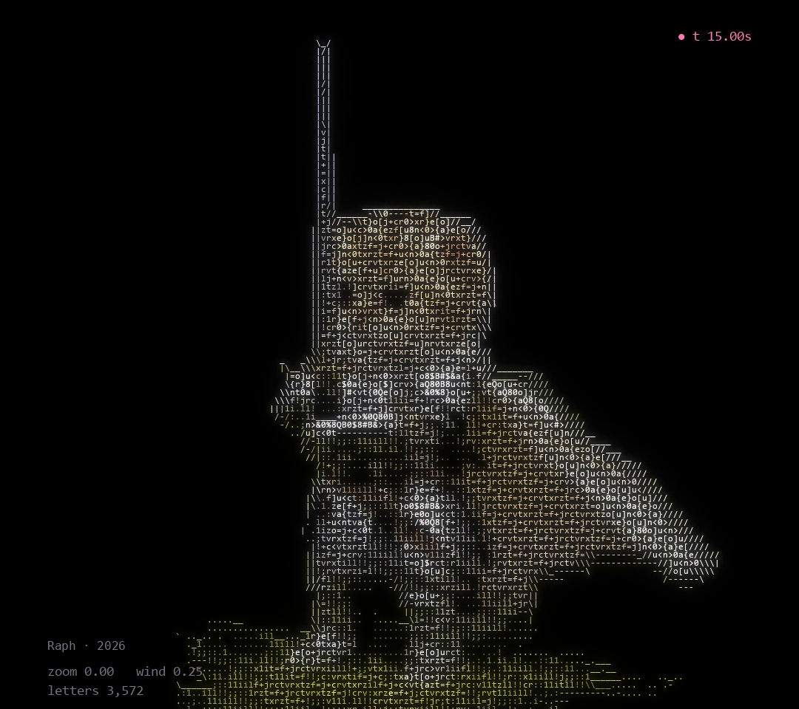
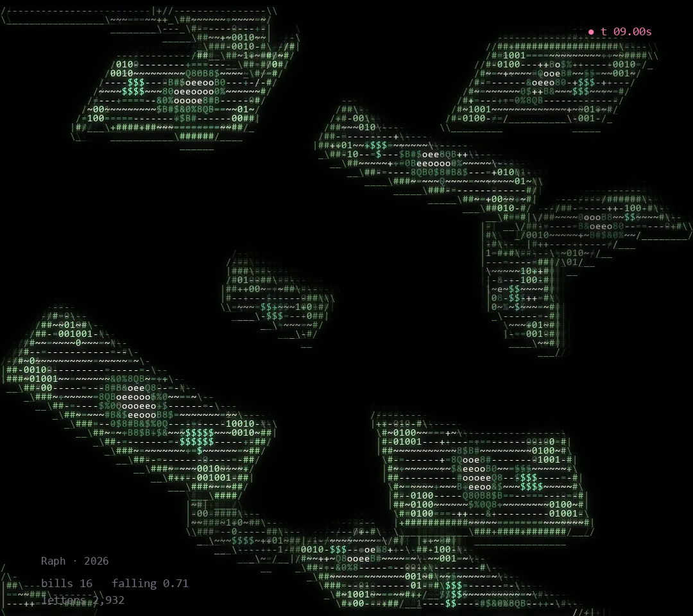
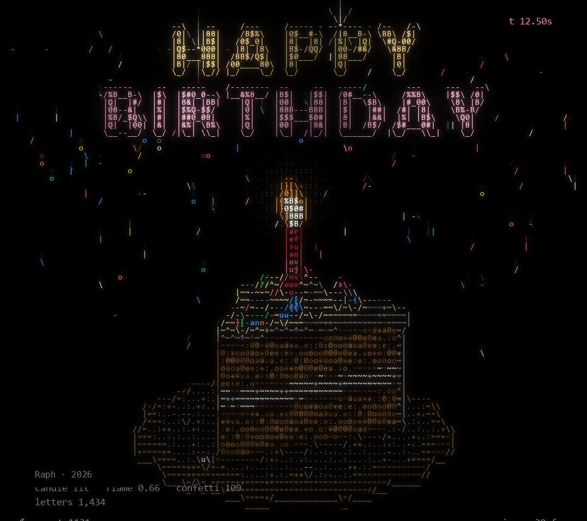
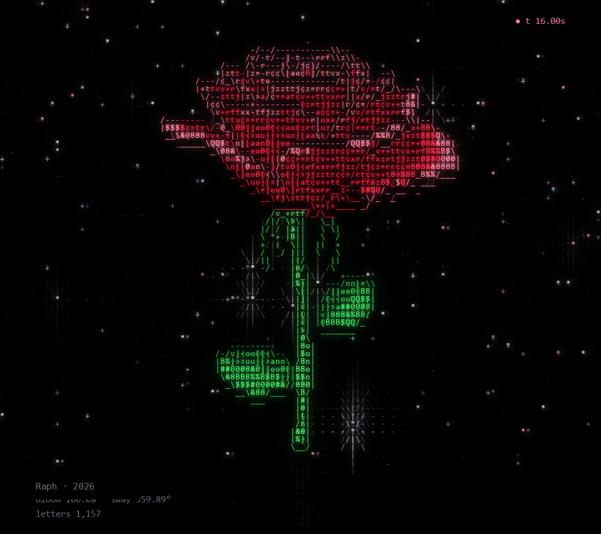
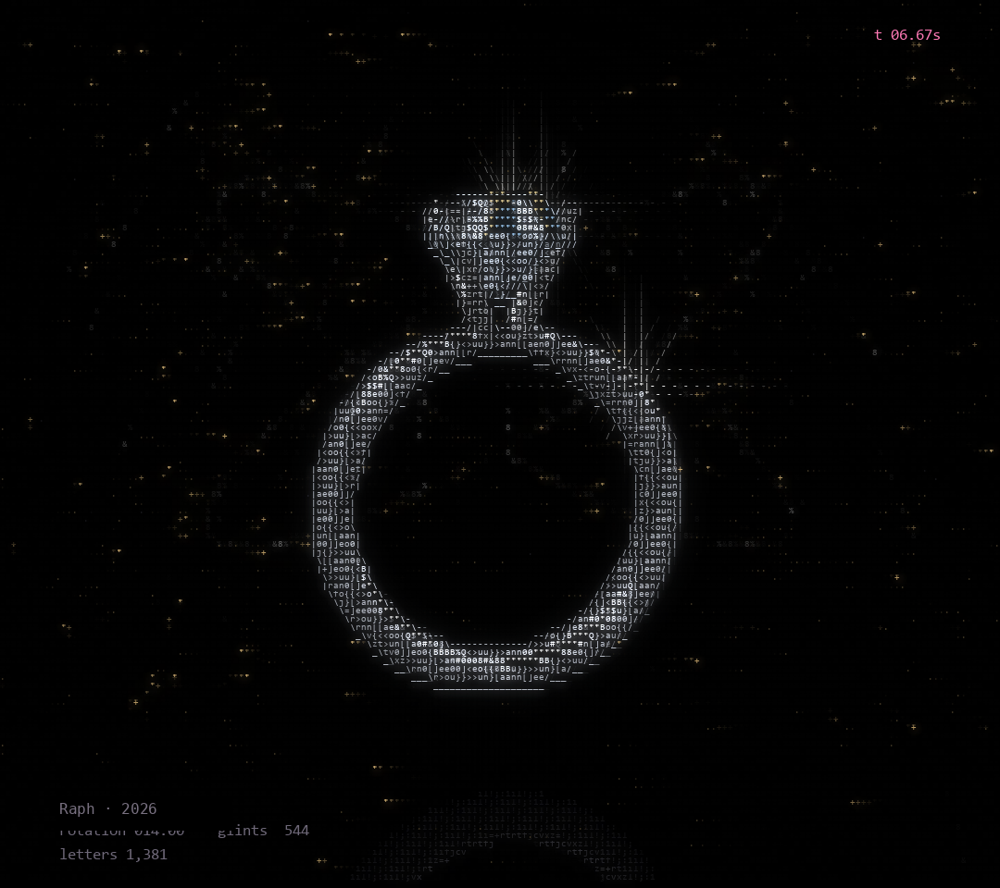

# Raph · ASCII Code Art

Raph is a creative coder who writes artworks in Python.
Every piece is drawn only with letters, numbers and symbols.

This repository is an archive of the works and a technical portfolio:
what each piece is, why it was made, and which techniques shaped it.

## Works

| | Work | Year | Source code |
|---|---|---|---|
|  | [CAT KNIGHT](CAT-KNIGHT/) | 2026 | full code, in this repository |
|  | [MONEY RAIN](MONEY-RAIN/) | 2026 | free, in this repository |
|  | [HAPPY BIRTHDAY (Birthday Cake)](BIRTHDAY-CAKE/) | 2026 | free, in this repository |
|  | [IN BLOOM (Rose)](ROSE/) | 2026 | free, in this repository |
|  | [WILL YOU (Diamond Ring)](DIAMOND-RING/) | 2026 | free, in this repository |

More works will be added over time, including small standalone pieces released as free, open code.

## Live in the browser

Every work also runs on the web (GitHub Pages, built with [pygbag](https://pypi.org/project/pygbag/)):

- Gallery: https://raphabdurakhmanov.github.io/Raphss/
- CAT KNIGHT: https://raphabdurakhmanov.github.io/Raphss/cat-knight/
- MONEY RAIN: https://raphabdurakhmanov.github.io/Raphss/money-rain/
- HAPPY BIRTHDAY: https://raphabdurakhmanov.github.io/Raphss/birthday-cake/
- IN BLOOM: https://raphabdurakhmanov.github.io/Raphss/rose/
- WILL YOU: https://raphabdurakhmanov.github.io/Raphss/diamond-ring/

Browser versions live in `web/<name>/main.py` (same code, with an async main loop and bundled DejaVu fonts).

## Technology

Python · NumPy · pygame-ce · Pillow. Written from scratch, no 3D software or image assets.

---

© 2026 Raph. All rights reserved.
Images and videos in this repository may not be reused without permission.
